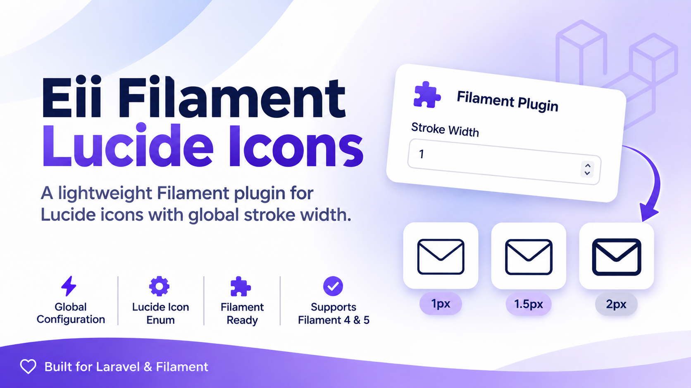

# Eii Filament Lucide Icons



A lightweight Filament plugin that integrates Lucide icons with configurable global stroke width.

Built on top of [Blade Lucide Icons](https://github.com/PascaleBeier/blade-lucide-icons), this package provides a convenient Lucide icon enum for Filament and allows developers to configure the default stroke width from their Panel Provider.

## Features

- Lucide icon enum for Filament resources, forms, tables, and actions.
- Configure the default stroke width globally.
- Supports decimal stroke widths.
- Individual icons can override the default stroke width.
- Compatible with Filament 4 and Filament 5.
- Lightweight implementation with minimal dependencies.

## Requirements

- PHP 8.2+
- Laravel 11+
- Filament 4.x or 5.x

## Installation

Install through Composer:

```bash
composer require eii/filament-lucide-icons
```

## Usage

### 1. Register the plugin

Register the plugin in your Filament Panel Provider.

```php
use Eii\FilamentLucideIcons\FilamentLucideIconsPlugin;

public function panel(Panel $panel): Panel
{
    return $panel
        ->plugins([
            FilamentLucideIconsPlugin::make()
                ->strokeWidth(1),
        ]);
}
```

The default stroke width is `2`.

You can customize it using:

```php
->strokeWidth(1)
```

Other supported values include:

```php
->strokeWidth(1.5)
->strokeWidth(1.25)
->strokeWidth(2)
```

### 2. Use Lucide icons

Import the enum:

```php
use Eii\FilamentLucideIcons\Enums\LucideIcon;
```

Use it in Filament components:

```php
TextInput::make('email')
    ->prefixIcon(LucideIcon::Mail);
```

Use it as a resource navigation icon:

```php
protected static string|BackedEnum|null $navigationIcon =
    LucideIcon::UsersRound;
```

The enum can be used anywhere Filament accepts a scalable icon.

### 3. Override individual icons

The global stroke width acts as the default.

Individual Blade icons can still specify their own stroke width:

```blade
<x-lucide-server stroke-width="2" />
```

This overrides the configured default for that icon only.

## Configuration

| Method | Default | Description |
|---|---|---|
| `strokeWidth()` | `2` | Sets the default Lucide SVG stroke width |

Example:

```php
FilamentLucideIconsPlugin::make()
    ->strokeWidth(1);
```

The setting is applied to the Lucide icon set globally through Blade Icons configuration.

If multiple Filament panels are registered, they share this global setting. Different stroke widths per panel are not supported.

## Dependencies

This package uses:

- [Blade Lucide Icons](https://github.com/PascaleBeier/blade-lucide-icons) - Lucide SVG rendering for Laravel Blade.
- [Filament](https://filamentphp.com/) - Admin panel framework.

## Credits

- [CodeWithDennis](https://github.com/CodeWithDennis/filament-lucide-icons) - Original Filament Lucide icon enum implementation.
- [Lucide](https://lucide.dev/) - Open-source icon library.
- [Pascale Beier](https://github.com/PascaleBeier) and [Dan Pock](https://github.com/mallardduck) - Blade Lucide Icons.

The Lucide enum is based on the MIT-licensed implementation by CodeWithDennis. Copyright and license notices are retained where applicable.

## License

This package is open-sourced software licensed under the MIT license.
